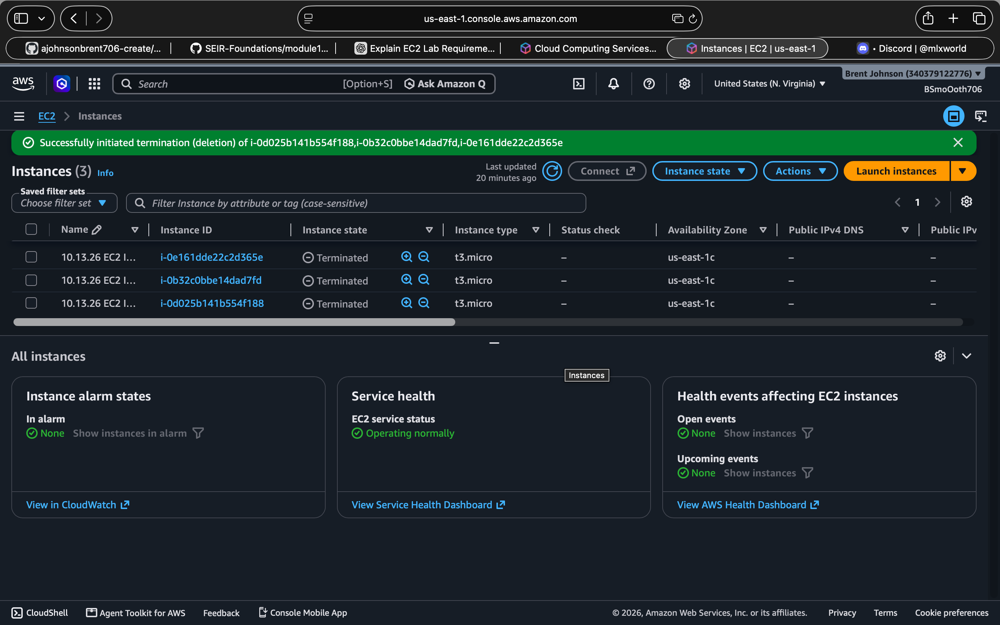
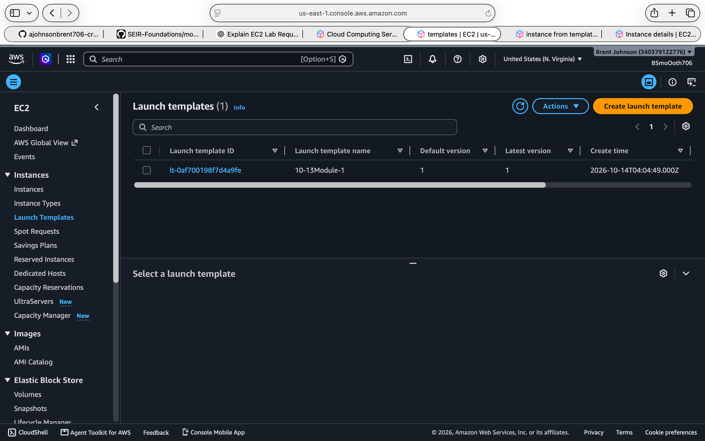

## EC2 Deployment Evidence

| Deployment | Public IPv4 Address | Connection Method | Screenshot | Instance Terminated? |
|---|---|---|---|---|
| 1 | 18.208.216.252 | EC2 Instance Connect | [View Deployment 1](screenshots/deployment-1.png) | Yes |
| 2 | 18.206.210.118 | EC2 Instance Connect | [View Deployment 2](screenshots/deployment-2.png) | Yes |
| 3 | 44.222.212.49 | EC2 Instance Connect | [View Deployment 3](screenshots/deployment-3.png) | Yes |

## Additional Evidence

| Evidence | Screenshot |
|---|---|
| Three running EC2 instances | [View Running Instances](screenshots/Instances_Running.png) |
| EC2 instances terminated | [View Terminated Instances](screenshots/Instances_Terminated.png) |
| Preserved EC2 launch template | [View Launch Template](screenshots/Launch_Template.png) |

## Deployment 1 — Initial EC2 Launch

Instance ID: i-0e161dde22c2d365e
Private IPv4: 172.31.27.123
Instance Type: t3.micro

For my first deployment, I launched an Amazon Linux 2023 EC2 instance using the configured launch template. After the instance started and became available, I established a remote connection using AWS EC2 Instance Connect.

Upon connecting, the SEIR Foundations dashboard appeared in the Linux terminal, confirming that the User Data script had configured the environment successfully.

The dashboard displayed system information, including CPU utilization, memory usage, disk capacity, uptime, and instance details.

Observed Results:

CPU: Approximately 0% busy, 2 vCPUs

Memory: 161 MiB used / 913 MiB total

Root Disk: 1.6 GB used / 8.0 GB total (20%)

Uptime: 21 minutes

## Deployment 2 — Repeating the Process

Instance ID: i-0b32c0bbe14dad7fd
Private IPv4: 172.31.18.243
Instance Type: t3.micro

For the second deployment, I repeated the EC2 launch process using the saved launch template. This allowed me to reuse the operating system, instance configuration, and Bash User Data settings without manually configuring everything again.

I successfully connected through EC2 Instance Connect and observed the SEIR dashboard.

This deployment reinforced my understanding of how launch templates support repeatable infrastructure deployments.

Observed Results:

CPU: Approximately 0% busy, 2 vCPUs

Memory: 152 MiB used / 913 MiB total

Root Disk: 1.6 GB used / 8.0 GB total (20%)

Uptime: 22 minutes

## Deployment 3 — Independent Repetition

Instance ID: i-0d025b141b554f188
Private IPv4: 172.31.19.253
Instance Type: t3.micro

For my third deployment, I repeated the launch and connection process using the preserved EC2 launch template.

I successfully accessed the Amazon Linux 2023 server through EC2 Instance Connect and verified that the SEIR dashboard was functioning.

By the third deployment, the sequence of launching an instance, connecting to Linux, and reviewing system information had become more familiar.

Observed Results:

CPU: Approximately 0% busy, 2 vCPUs

Memory: 152 MiB used / 913 MiB total

Root Disk: 1.5 GB used / 8.0 GB total (19%)

Uptime: 23 minutes

## 4. Understanding the SEIR System Dashboard

### CPU — Central Processing Unit

CPU utilization measures how much processing capacity a server is using. Each t3.micro instance displayed 2 virtual CPUs (vCPUs). During my observations, CPU utilization was approximately 0%, indicating very little processing activity at that moment.

### Memory — Random Access Memory (RAM)

Memory is temporary working space used by the operating system and running applications. My instances displayed 913 MiB of total memory, with approximately 152–161 MiB being used. Monitoring memory helps identify when a server may need additional resources.

### Disk — Storage Utilization

Disk usage measures how much storage is occupied. My instances displayed approximately 1.5–1.6 GB used out of 8.0 GB total, or 19–20% utilization. Monitoring disk space helps prevent applications and operating systems from running out of storage.

### Uptime — Server Running Time

Uptime measures how long the operating system has been running since its last boot. My dashboards displayed uptimes of 21, 22, and 23 minutes. This information helps engineers identify recent restarts and understand server availability.

## 5. Lessons Learned Through Repetition

One task that became easier was launching EC2 instances and connecting through EC2 Instance Connect. Reusing the saved launch template made deployments more consistent and reduced repeated configuration. By the third deployment, I was more familiar with the process of launching, connecting, and examining the dashboard.

## 6. Errors Encountered and Troubleshooting

During my initial documentation review, I discovered that the original EC2 screenshots did not clearly display the public IPv4 addresses required for the evidence table.
To resolve this issue, I launched three additional EC2 instances using the preserved launch template. I successfully connected to each instance through EC2 Instance Connect, verified the SEIR Foundations dashboard, and captured updated screenshots containing the correct instance information.
After verifying the three distinct public IPv4 addresses and updating my README documentation, I terminated all three additional EC2 instances to prevent unnecessary AWS charges.

## 7. Resource Cleanup and Cost Management

- [x] Confirmed all three practice EC2 instances were terminated.
- [x] Verified the termination status in the AWS Console.
- [x] Confirmed the launch template was preserved for future labs.
- [x] Checked for unnecessary remaining billable resources.

### Termination Evidence

### Launch Template Evidence

## 8. Conclusion

This lab provided practical experience with the lifecycle of an Amazon EC2 instance: launching, connecting, observing, documenting, and terminating cloud infrastructure.

I successfully connected to three Amazon Linux 2023 instances through EC2 Instance Connect and examined CPU, memory, disk, and uptime information.

The repeated deployments strengthened my understanding of AWS infrastructure, remote Linux administration, and reusable launch templates.

  